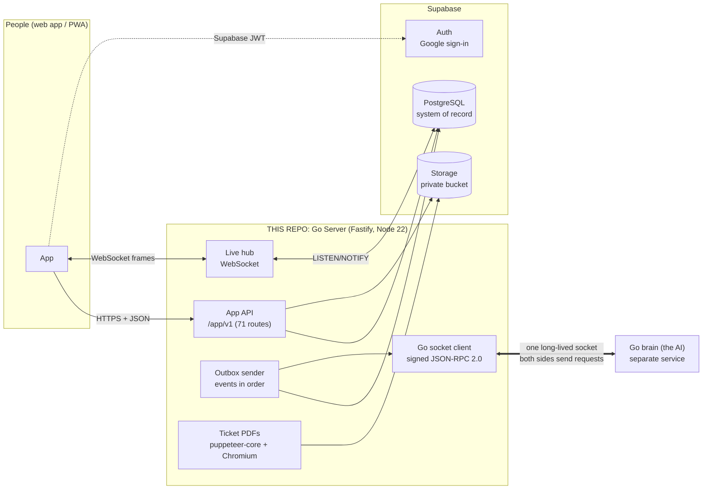
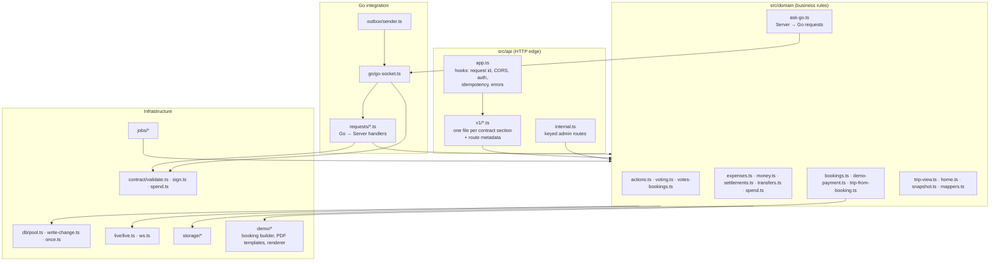
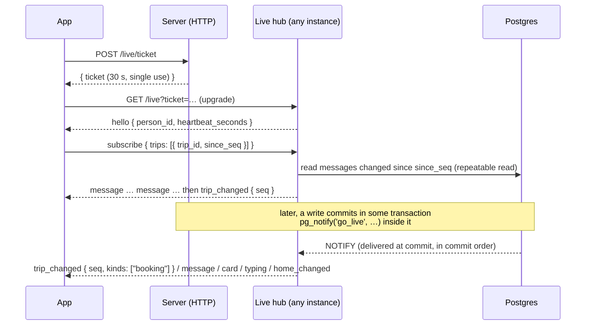
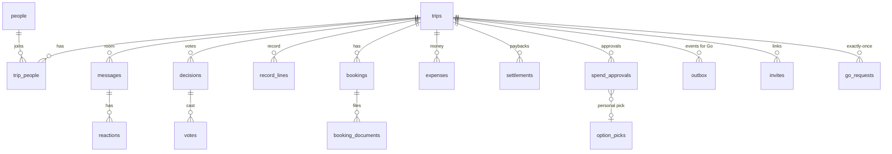
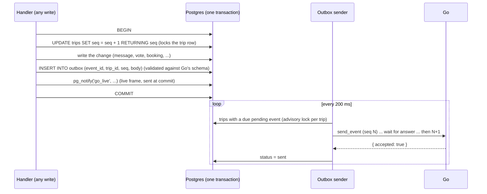
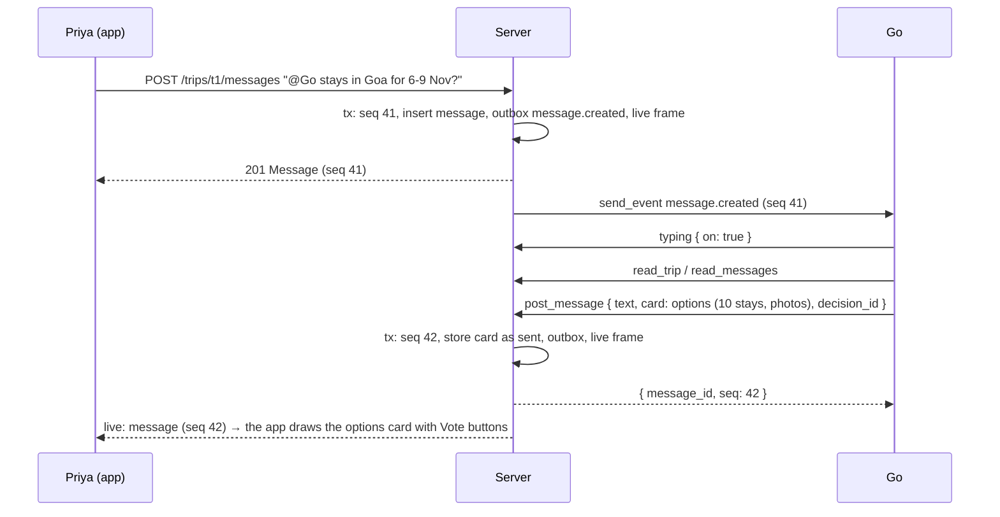
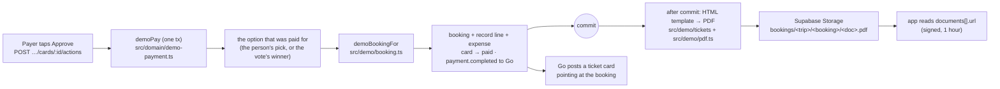

# Architecture: the Go Server

> **Go** is an AI travel planner that lives *inside* a group chat. Friends plan a trip together in one room and Go
> joins the conversation: it suggests places and stays, runs votes, keeps the plan, tracks shared money, and books.
> This repository is the **Server**: the system of record that sits between the **app** that people use and the
> **Go brain** (the AI). It is TypeScript on Node 22, Fastify, PostgreSQL (Supabase), and runs on Railway.
>
> ("Go" is the product's name, not the programming language.)

This document explains how the Server is built and why. Every claim names the file that implements it, so you can
check it.

---

## Contents

1. [System context](#1-system-context)
2. [Design principles](#2-design-principles)
3. [Components (module map)](#3-components)
4. [Interface 1: the App API (REST)](#4-interface-1-the-app-api)
5. [Interface 2: live updates to phones (WebSocket)](#5-interface-2-live-updates-to-phones)
6. [Interface 3: the connection to Go (signed JSON-RPC)](#6-interface-3-the-connection-to-go)
7. [Data model](#7-data-model)
8. [The change log: one sequence number per trip](#8-the-change-log-one-sequence-number-per-trip)
9. [Key flows](#9-key-flows)
10. [Money](#10-money)
11. [Demo bookings and ticket PDFs](#11-demo-bookings-and-ticket-pdfs)
12. [Security and privacy](#12-security-and-privacy)
13. [Reliability, ordering and idempotency](#13-reliability-ordering-and-idempotency)
14. [Background jobs](#14-background-jobs)
15. [Contracts and how they are enforced](#15-contracts-and-how-they-are-enforced)
16. [Testing strategy](#16-testing-strategy)
17. [Deployment and operations](#17-deployment-and-operations)
18. [Trade-offs and known limits](#18-trade-offs-and-known-limits)
19. [Glossary](#19-glossary)

---

## 1. System context



**Three parties and one rule each:**

| Party | Role | The rule |
|---|---|---|
| **App** (web/PWA, built by the App team) | What people tap: the trip room, votes, bookings, money | Talks **only** to this Server (`/app/v1`). It never calls Go directly; the one exception is opening Go's vault page from a short-lived link the Server hands out |
| **Server** (this repo) | Stores every trip, enforces every rule, keeps Go and the phones in step | The database is the truth. Every change is saved and announced in **one transaction** |
| **Go brain** (built by Go's team) | Understands the chat, searches ixigo, writes messages and cards | Acts only through **requests to the Server** ("post this message", "open a vote", "add a booking"); it reads the trip from the Server, never from its own memory |

---

## 2. Design principles

1. **One source of truth.** Postgres holds the trip. Go keeps only what it learns about people and its own working
   state. Every Go request is answered from the database, so any number of Server instances can run.
2. **Every change is an event, in order.** Each change to a trip takes the trip's next **change number (`seq`)** and
   writes an **outbox event** for Go in the *same transaction* ([§8](#8-the-change-log-one-sequence-number-per-trip)).
   Nothing is lost if a process dies mid-way, and Go and the phones see changes in the same order.
3. **Contract first.** Both interfaces are defined by written contracts (`docs/CONTRACT-APP.md`, `docs/CONTRACT-GO.md`)
   and by Go's machine-readable contract (`contract/*.json`, version **1.3.0**). Every frame to and from Go is
   validated against those schemas at runtime ([§15](#15-contracts-and-how-they-are-enforced)).
4. **Do each thing exactly once.** Go's writes carry `request_id`, the app's writes carry `Idempotency-Key` or a client
   id, card taps carry a press id, and events carry `event_id`. Repeats return the first answer ([§13](#13-reliability-ordering-and-idempotency)).
5. **Money needs two keys.** Go can never spend on its own word: the Server checks its *own* records and signs a
   one-time Ed25519 approval; the payer confirms separately ([§10](#10-money)).
6. **Privacy by construction.** Go never receives phone numbers, emails, UPI ids or anyone's private data; a booking,
   its tickets and per-person messages reach only the people they are for ([§12](#12-security-and-privacy)).
7. **Fail safe, fail visible.** A Go timeout becomes a clear app error, not a hang; a refused event is logged and the
   trip moves on; a failed PDF never undoes a payment; the start-up log proves each subsystem works.

---

## 3. Components



| Path | Responsibility |
|---|---|
| `src/main.ts` | Start-up and wiring: config, pool, **migrations**, live listener, storage, PDF self-test, Go socket, outbox sender, jobs, auth, HTTP server, graceful shutdown, one-time data repairs |
| `src/config.ts` | Environment variables, feature flags (`FEATURE_*`), and the socket URL (`socketUrl`) |
| `src/context.ts` | `Ctx`, the request-wide context (pool, live, storage, signing key, features, contract level, a test clock) |
| `src/api/app.ts` | The Fastify shell: request id, CORS, JSON parsing, the error envelope, sign-in, `Idempotency-Key`, section registration |
| `src/api/auth.ts` | `SupabaseAuth` (JWKS / HS256 verification; creates the person on first sign-in) and `DevAuth` (local only) |
| `src/api/v1/*.ts` | One file per section of the app contract. Each exports `routes: RouteMeta[]` (method, path, title, summary, example) and `register()` |
| `src/api/bodies.ts`, `input.ts` | Strict JSON-Schema body definitions; no coercion; unknown fields are 422 |
| `src/api/internal.ts` | `/internal/v1` support routes (look up, delete, forget, reset a test trip), off unless `INTERNAL_API_KEY` is set |
| `src/domain/*` | All business rules (one file per concept, listed in [§9](#9-key-flows) and [§10](#10-money)) |
| `src/requests/*` | The handlers for Go's 20 requests (`read_trip`, `post_message`, `open_vote`, `add_booking`, …) |
| `src/go/go-socket.ts` | The client for the socket to Go: signing, reconnect, heartbeat, request/answer matching, validation, logging |
| `src/outbox/sender.ts` | Delivers outbox events to Go, one trip at a time and in `seq` order, with retries |
| `src/live/live.ts`, `ws.ts` | Postgres `LISTEN/NOTIFY` fan-out and the app's WebSocket hub |
| `src/db/*` | Transactions with an `AsyncLocalStorage` context, `nextSeq`/`emit` (the change log), `once` (exactly-once store), ids |
| `src/storage/*` | Supabase Storage (private bucket, signed URLs) and an in-memory stand-in for tests and laptops |
| `src/contract/*` | Go's contract in code: Ajv validation of every frame, HMAC request signing, Ed25519 spend approvals |
| `src/demo/*` | Demo bookings: the booking builder, seeded fake ids, the e-ticket and voucher HTML templates, the PDF renderer |
| `src/jobs/*` | Periodic work: closing votes on time, sweeps, refreshing idea photos from Go |
| `migrations/*.sql` | The schema (16 migrations, applied at start under an advisory lock) |
| `contract/*.json` | Go's official contract 1.3.0 (`go.json`, `socket.json`, `methods.json`), the signing test vectors, and our additive overlay |

---

## 4. Interface 1: the App API

**71 routes under `/app/v1`**, defined in [`docs/CONTRACT-APP.md`](docs/CONTRACT-APP.md) (contract) and
[`docs/API.md`](docs/API.md) (the same, plus run/test notes and the route index, Appendix C). A test fails if a route is
added without its metadata (`tests/rev4-whole.test.ts`).

| Section | Routes (examples) |
|---|---|
| Live | `POST /live/ticket`, `GET /live` (WebSocket upgrade) |
| Me | `GET/PATCH/DELETE /me`, `PUT/DELETE /me/upi`, `POST /me/vault-link` |
| Home | `GET /home` (trips, money owed, every open item), `GET /discover/ideas` |
| Invites | `GET /invites/:code` (public preview), `POST /invites/:code/accept` |
| Trips | `POST /trips`, `GET/PATCH /trips/:trip`, invite/rotate, join answers, leave, read marker |
| Room | `GET/POST …/messages`, edit, delete, reactions, `GET …/catch-up` |
| Cards | `POST …/cards/:card_id/actions` (taps go to Go), option details, cards by kind |
| Votes | open, vote, close, cancel, mandate confirm/decline, the trip record (undo/redo) |
| Money | `GET …/money`, transactions, expenses (add, re-split, remove), settlements, UPI pay link |
| Bookings | list, one booking, ticket file, add, edit, cancel-vote, itinerary |
| Needs you | `GET …/needs-you` |
| You (Go's memory) | what Go knows about me, carry-over, delete a fact, forget me |
| Places | city search, top cities, `GET /config` (feature flags), `GET /health` |

**The request pipeline** (`src/api/app.ts`, in order):

1. `onRequest`: assign `X-Request-Id`; add CORS headers for the exact allowed origins (`APP_ORIGINS`, no wildcard);
   answer preflights.
2. Parse JSON (an unreadable body is 400; every rule after that is **422 with the field named**).
3. **Sign-in:** `Authorization: Bearer <Supabase access token>` is verified locally (`jose`, JWKS), and the person row
   is created on the first call. A deleted account's token is refused.
4. **Idempotency:** a write with `Idempotency-Key` is answered once; a replay returns the stored answer with
   `Idempotent-Replayed: true` (`src/api/idempotency.ts`, table `idempotency_keys`, 24 h).
5. **Membership first:** every `/trips/:trip/…` route runs `memberFirst` as a `preValidation` hook, so a stranger gets
   **403 before any query or body rule**, and learns nothing about the route (`src/api/v1/shared.ts`).
6. The handler calls a domain function, which re-checks membership inside its transaction.
7. Errors always use one envelope: `{ error: { code, message, field, retry_after_seconds, request_id } }`
   (`src/api/errors.ts`).

Rate limits (in memory, per instance) protect the expensive paths: messages 30/min, reactions 20/min, card taps
10/min, option details 10/min, votes 20/min, vault links 6/min, uploads 20/min, invite preview 30/min per IP.

---

## 5. Interface 2: live updates to phones

The app keeps one WebSocket open (`src/live/ws.ts`). Frames are **pointers, not copies**: they tell the app *what*
changed and the app re-reads it, so a frame never leaks data the reader may not see.



- **Tickets** are single-use and valid 30 s; one socket per device (a newer one replaces the older, close code 4000);
  heartbeats every 25 s (two missed pongs close the socket).
- **Fan-out across instances** uses Postgres `LISTEN/NOTIFY` on channel `go_live` (`src/live/live.ts`). A notice
  published **inside** a transaction is sent by Postgres **at commit, in commit order, never on rollback**, which is
  how frames for one trip can never arrive out of order (`txContext` in `src/db/pool.ts`).
- **Per-trip ordering** inside an instance: one promise queue per trip (`inOrder`). A `message` frame whose row has
  already moved on is dropped, because the later notice carries the newer state.
- **Visibility is applied per subscriber:** a message meant for some people (`visible_to_person_ids`) is only sent to
  them. A person who leaves stops receiving the trip immediately.
- **Replay** after a reconnect sends what changed since the app's last `seq`, or one `resync` frame when that is more
  than 200 messages.

---

## 6. Interface 3: the connection to Go

The Server **dials Go** and keeps **one long-lived WebSocket** open. Both sides send JSON-RPC 2.0 requests on it.

```text
wss://<go-host>/v1/socket?instance=<process name>&server=<deployment name>
x-go-signature: t=<unix>,v1=<hex HMAC-SHA256(secret, "<t>\nGET\n<path+query>\n")>
```

- **Signed handshake** (`src/contract/sign.ts`), with a fresh signature on every connect, because Go accepts each
  signature once. `server=go-server-prod` names the deployment, so trips stay with this Server across redeploys.
- **Resilience** (`src/go/go-socket.ts`): reconnect after 1, 2, 5, 10, then every 30 s; unanswered requests are re-sent
  with the **same ids** after a reconnect; 40 s idle timeout; 1 MiB frames.
- **Validation both ways:** every incoming request is checked against Go's schema (a bad one is answered 422,
  `invalid`); every request the Server sends and every answer it receives is checked too (`askGo` in
  `src/domain/ask-go.ts`).
- **Observability:** every error the Server answers Go with is logged as one line (no parameters, no personal data);
  `LOG_GO_TRAFFIC=1` writes every frame to `logs/go-traffic.jsonl`, and `pnpm inspect` summarises it.

### Go → Server: 20 requests (`src/requests/*`)

Each write is wrapped in `once(trip_id, request_id)` and must answer within 1.8 s (else 503, and Go retries with the
same id).

| Request | What it does | Event Go hears back |
|---|---|---|
| `read_trip`, `read_messages` | Read the trip snapshot / messages from the database | none |
| `post_message` | Go writes in the room, with or without a card (stored exactly as sent) | `message.created` |
| `replace_card` | Update one of Go's cards in place | none (moves the message's `seq`) |
| `typing` | "Go is typing…" (notification) | none |
| `add_reaction`, `remove_reaction` | Go's emoji reactions | `reaction.added` / `.removed` |
| `update_trip` | Destination, dates, title, itinerary, the group budget | `trip.updated` |
| `open_vote`, `add_vote_options`, `close_vote` | Votes, including "see more" adding options to the same vote | `decision.*` |
| `set_mandate` | What the group allowed after a vote: choice, cap, payer | `mandate.set` |
| `add_record_line`, `update_record_line` | The trip's record of decisions and to-dos | `record.changed` |
| `add_booking`, `update_booking` | Bookings (with an approval when paid) | `booking.changed` |
| `add_expense`, `update_expense` | Expenses, and re-splitting one in place | `expense.changed` |
| `request_spend_approval`, `cancel_spend_approval` | The Server's signed approval before any payment | none |

### Server → Go requests

| Request | Used for |
|---|---|
| `send_event` | Every change to a trip, from the outbox ([§8](#8-the-change-log-one-sequence-number-per-trip)) |
| `card_tap` | A person tapped a button on one of Go's cards (tap ids are tied to the person, so one person can't replay another's tap) |
| `catch_up` | A summary for someone back after 3 h or 15+ unread messages |
| `get_person`, `update_person`, `delete_fact`, `forget_person` | The "What Go knows about me" screen and "forget me" |
| `vault_link` | A short-lived link to Go's vault (cards, travel documents), in a sheet or embedded |
| `get_option_details` | Full details of a stay or flight option, cached for an hour |
| `place_info` | Photos and facts for the "ideas" carousel (background job) |

---

## 7. Data model

PostgreSQL, 16 migrations in `migrations/`, applied at start under an advisory lock and recorded in
`schema_migrations`.



| Table | Holds |
|---|---|
| `people` | One row per person: name, photo, contact details (never sent to Go), Supabase `auth_user_id`, `deleted_at` |
| `trips` | Title, status, destination (JSON `Place`), dates, stay, currency, itinerary, the group budget, and **`seq`**, the trip's change counter |
| `trip_people` | Membership: role, joined/left, the person's join answers (from city, when they can leave, notes), Go paused, read marker |
| `messages` | The room: author (person / Go / system), text, attachments, the **raw card** Go sent, mentions, `visible_to_person_ids`, money-line `ledger`, `seq` and `updated_seq` |
| `reactions` | Emoji per message (Go's reactions have no person) |
| `decisions`, `votes` | Votes (choice / yes-no), options, closing time, result, the **mandate** (payer, cap, confirmed/declined) |
| `record_lines` | The trip record: decided, agreed, open, doing, booked |
| `bookings`, `booking_documents` | Bookings (journey, place, passengers, details) and their files (stored in Storage, opened through signed links) |
| `expenses`, `settlements` | Shared money: who paid, split between whom; paybacks |
| `spend_approvals`, `option_picks` | Signed one-time approvals; the options people picked (for personal tickets) |
| `outbox` | Every event for Go, unique per `(trip_id, seq)`, with status, attempts, next attempt |
| `go_requests` | The exactly-once store: the first answer to each `(trip_id, request_id)` |
| `idempotency_keys`, `live_tickets`, `invites`, `uploads` | App idempotency, socket tickets, invite links, upload slots |
| `places_cities`, `ideas`, `option_details`, `checkins` | City search data, the ideas carousel, cached option details, web check-in state |

**Row-level security:** every table has RLS enabled with no policies, and the Supabase `anon` / `authenticated` roles
have no privileges (`migrations/003_supabase.sql` and later). Only the Server, as table owner, can read or write: the
public Supabase keys can't touch the data.

---

## 8. The change log: one sequence number per trip

This is the core mechanism that keeps the app, the database and Go consistent.



- `nextSeq` (`src/db/write-change.ts`) increments `trips.seq` **and locks the trip row**, so changes to one trip
  commit strictly in `seq` order. `emit` builds `{ event_id, trip_id, seq, occurred_at, type, data }`, **validates it
  against Go's `Event` schema** (an invalid event aborts the transaction before commit) and inserts it into `outbox`.
- The **outbox sender** (`src/outbox/sender.ts`) holds a per-trip advisory lock, sends a trip's events **one at a time
  in `seq` order**, and waits for each answer. Temporary failures (429, 5xx, timeout) retry after 1 s, 5 s, 30 s, 2 min,
  10 min, then every 10 min; the order is kept by waiting. A permanent refusal is marked `failed` and the trip moves
  on, so one bad event never blocks a trip forever.
- **Lock order** (prevents deadlocks): person row → membership row → vote rows → booking rows → the trip's `seq`.
- A few changes take a `seq` without an event (Go's own `replace_card`, the demo pay card turning "paid", ticket files
  being attached); the app still sees them through `updated_seq`.

---

## 9. Key flows

### 9.1 A trip starts

1. `POST /trips` → `createTrip` (`src/domain/actions.ts`), one transaction: the trip, its first invite, the organizer;
   `trip.created` (seq 1) carries the whole snapshot to Go; the room's first line "Trip created · Aarav joined".
2. Friends open `https://<app>/invite/<code>`: a public preview (`GET /invites/:code`), then `POST …/accept`, which
   sends `person.joined` and posts "Priya joined".

### 9.2 A message, and Go replying



A person can pause Go: their later messages still reach Go as `withheld`, with no words in them.

### 9.3 From a vote to a booking

1. **Vote.** Go opens it (`open_vote`) and posts an options card carrying `decision_id`; people vote on the card
   (`PUT …/decisions/:id/vote`). "See more" adds options to the **same** vote (`add_vote_options`). The vote closes when
   everyone has voted, on time (a job), or by the opener: `decision.closed`, a **decided** line in the record, and
   "Villa Sol won · 4 votes" in the room (`src/domain/voting.ts`).
2. **Mandate.** Go sets what the group allowed (`set_mandate`: choice, cap, payer); the payer confirms in the app.
3. **Spend approval.** Go asks `request_spend_approval`. The Server checks **only its own rows** (`spendCheck` in
   `src/domain/spend.ts`): the vote is closed, a mandate exists and was confirmed, the currency matches, the amount is
   within the cap, it's refundable if required, it isn't already booked, and no approval is outstanding. Then it signs
   an **Ed25519 JWS** valid for 10 minutes (`src/contract/spend.ts`). A personal ticket uses the 1.3 "ticket" form: it
   is granted only against that person's own recent pick on Go's card, within 5% of the shown price.
4. **Booking.** Go books with the approval (`add_booking`), which the Server re-checks and marks used: `booking.changed`,
   the decided line becomes **booked**, and "Villa Sol booked" appears in the room.
5. **The trip fills itself in.** A booking fills the trip's **empty** destination (always a place, never a hotel name)
   and stay. It never sets dates; those are Go's and the people's (`src/domain/trip-from-booking.ts`).

### 9.4 Needs you and home

`GET /trips/:trip/needs-you` and `GET /home` list **only what the person can act on now**: votes they haven't cast,
mandates waiting on them, Go cards with a button **they** can press, open record lines naming them, and money they owe
(`needsYouIn` in `src/domain/actions.ts`). Each item carries the target its popup opens. `home_changed` frames keep the
home screen fresh.

### 9.5 Leaving and deleting an account

`DELETE /me` (`src/domain/account.ts`) asks Go to forget the person everywhere **first**; if Go cannot, nothing is
deleted (502). Then the name becomes "Former member" (including in past room lines), join answers are cleared, the
person leaves every trip, contact details are erased, and their token stops working.

---

## 10. Money

All amounts are integers in the smallest unit plus a currency (`540000` + `INR` = ₹5,400), never floats.

| Piece | Where | Rule |
|---|---|---|
| Expenses | `src/domain/expenses.ts` | Count as soon as added; equal split between `split_person_ids`. Re-splitting changes the same expense (the app's "fix the split", Go's `update_expense`), never adds a second one |
| Balances and transfers | `src/domain/money.ts` | Pure functions: shares, balances, and the **fewest payments** that settle everyone, net of recorded paybacks |
| Paybacks | `src/domain/settlements.ts` | "I paid Rahul ₹5,800" counts at once (`settlement.recorded`) |
| UPI | `src/domain/transfers.ts` | A `upi://pay` link to someone you owe right now, built on request and never stored |
| Room lines | `src/domain/ledger-lines.ts` | Every money movement posts a line ("Priya added Dinner · ₹1,000 · split 5 ways") |
| A booking's expense | `coverSplitPeople` | Splitting a booking's cost with someone adds them to the booking, so they can see it and open its voucher |

---

## 11. Demo bookings and ticket PDFs

For the hackathon demo **no real money moves**. When the payer taps **Approve** on Go's pay card, the Server takes the
payment as done and produces a realistic booking with a downloadable ticket.



- **The booking is built from the exact option paid for:** a flight's route, times, carrier and number, or a stay's
  name, address, room type and price. What Go doesn't provide is filled in **deterministically from the approval id**
  (PNR, e-ticket numbers, seats, booking ids), so a retry gives the same ticket. Everything is marked **DEMO**.
- **Dates are never invented:** a stay uses the trip's dates, else the dates in the option's ixigo link, else "To be
  confirmed".
- **PDFs** are ixigo-style e-tickets (one per flight leg) and hotel vouchers, rendered from HTML templates by
  **puppeteer-core** with the machine's Chromium (`PUPPETEER_EXECUTABLE_PATH`), one shared browser, about 0.3 s each.
  The start-up log proves it works: `ticket pdfs: ok: chromium /usr/bin/chromium, a test PDF in 321 ms`.
- Rendering happens **after** the payment commits, so a slow or failed render can never undo a payment.

---

## 12. Security and privacy

| Concern | How it is handled |
|---|---|
| **Authentication** | Supabase Auth (Google). Tokens are verified locally against Supabase's JWKS (issuer, audience, `role = authenticated`); the anon key can't sign in. Dev tokens exist only locally and are refused in production |
| **Authorization** | Membership is checked first on every trip route (403 before any other rule), and again inside each transaction and on every socket subscription |
| **Server ↔ Go** | HMAC-signed socket handshake; every frame validated against the contract; money approvals signed with Ed25519 and checked again at booking time |
| **Data minimisation to Go** | `personForGo` sends only name, photo, role, join answers and pause state, never email, phone or UPI id. Messages from someone who paused Go go with no text |
| **Per-person visibility** | Messages with `visible_to_person_ids` (each traveller's own flight options), bookings (only the people covered and the payer), ticket files, and private itinerary items all reach only their people. Anyone else gets 404, so ids can't be probed |
| **Files** | A private bucket; uploads through signed PUT links (25 MB, MIME allow-list); every read re-signs links (1 h) |
| **Database** | RLS on, no policies, public roles revoked; verified TLS to Supabase |
| **Secrets** | Only in environment variables. Logs never include signatures, parameters, names, emails or keys; Go's live-view links are stripped from logs |
| **Support access** | `/internal/v1` exists only when `INTERNAL_API_KEY` is set, is checked in constant time, has no CORS (not callable from a browser), is rate-limited, and logs ids only |

---

## 13. Reliability, ordering and idempotency

| Guarantee | Mechanism |
|---|---|
| Nothing is lost between the database and Go | The outbox is written in the same transaction as the change; the sender retries until accepted (up to 24 h) |
| Go sees a trip's changes in order | One `seq` per trip; the trip row lock; a per-trip advisory lock in the sender; one event in flight per trip |
| Phones see changes in order | `pg_notify` inside the transaction (delivered at commit, in commit order) plus a per-trip queue in the hub |
| Each Go write happens once | `once(trip_id, request_id)` stores the first answer in `go_requests`; a repeat returns it |
| Each app write happens once | `Idempotency-Key` (24 h), client message ids, card press ids |
| Several Server instances | Every answer comes from Postgres; live fan-out through `LISTEN/NOTIFY`; jobs use `FOR UPDATE SKIP LOCKED` |
| Go is slow or down | App calls that need Go time out with a clear `go_unavailable` (or a polite refusal toast); events wait in the outbox |
| Redeploys | Graceful shutdown drains the sender; `server=go-server-prod` keeps trips attached to this deployment |

---

## 14. Background jobs

`startJobs` (`src/jobs/votes.ts`) runs every 15 s on every instance:
1. Close votes whose time is up.
2. Sweep old idempotency keys, unused uploads and expired live tickets.
3. Refresh one idea's photos from Go (`place_info`), daily after a full answer, hourly after a partial one.

The outbox sender (every 200 ms) and the live hub's heartbeat (every 25 s) run continuously.

---

## 15. Contracts and how they are enforced

| Contract | File(s) | Enforced by |
|---|---|---|
| Server ↔ Go, official **1.3.0** | `contract/go.json` (OpenAPI shapes), `contract/methods.json` (29 methods), `contract/socket.json` (AsyncAPI), from Go's repo `vestra-ai/go-brain` | `src/contract/validate.ts` (Ajv 2020): every incoming request, outgoing request, answer and event |
| Our additive overlay | `contract/extensions-1.1.json`: web check-in methods, the demo `payment.completed` event, `update_expense` | `mergeAdditive` can **only widen** the official schemas (never tighten or remove), proven by a test |
| App ↔ Server, rev 4/5 | `docs/CONTRACT-APP.md`, `docs/API.md` | Strict body schemas (`src/api/bodies.ts`), route metadata, contract tests, and a test that every Booking the demo builds passes Go's `Booking` schema |
| Signing | `contract/test-vectors/*.json` | `src/contract/sign.ts` and `spend.ts` are tested against Go's official vectors |

TypeScript types for Go's shapes are generated from `go.json` (`pnpm gen:types` → `src/contract/schema.d.ts`).

---

## 16. Testing strategy

**660+ tests in 75 files**, run with `pnpm test` (Vitest). No Docker or network is needed: a real PostgreSQL starts
in-process (`embedded-postgres`), each test file gets its own database, and Go is a **mock Go** speaking the real signed
protocol over a real WebSocket.

| Layer | Examples |
|---|---|
| Pure logic | money maths and fewest-payments transfers, spend checks, the automatic trip name, address → place, PDF page counting |
| Contract | every event and answer validated against Go's official schemas; the overlay only widens; signing and JWS against the official test vectors |
| API behaviour | each route's happy path, its documented errors, CORS, idempotency, rate limits, membership-before-validation (a test walks **every** trip route) |
| Concurrency | simultaneous votes and taps, the lock order, live frames in commit order under load |
| Live socket | tickets, replay, resync, two devices, frame order, leavers stop receiving |
| End to end | `tests/flows.e2e.test.ts` walks every documented flow; `tests/fake-go.e2e.test.ts` and `tests/main.e2e.test.ts` run the real `src/main.ts` process against a fake Go |
| Real Chromium | `tests/demo-tickets.test.ts` renders real PDFs when `PUPPETEER_EXECUTABLE_PATH` is set |

The Server has also been tested repeatedly against the **real production Go** (multi-person trips through every
feature: hundreds of events, zero failures). The method and results are in [`docs/REAL-GO-TESTING.md`](docs/REAL-GO-TESTING.md).

---

## 17. Deployment and operations

| Piece | Choice |
|---|---|
| Hosting | **Railway**, service `server`, built by Railpack from `main` (every push deploys); `pnpm start` |
| Database | **Supabase Postgres** through the session pooler (keeps `LISTEN/NOTIFY` and advisory locks working), verified TLS (`certs/prod-ca-2021.crt`) |
| Files | **Supabase Storage**, one private bucket (`go-files`) |
| Auth | **Supabase Auth**, Google provider |
| PDFs | Chromium and fonts installed by Railway (`RAILPACK_DEPLOY_APT_PACKAGES`), `PUPPETEER_EXECUTABLE_PATH=/usr/bin/chromium` |
| Health | `GET /health` → `{"ok":true,"go":true}` |

**What a healthy start-up log looks like:**

```text
storage: supabase bucket go-files
ticket pdfs: chromium /usr/bin/chromium
go server name: go-server-prod
go contract: 1.1 (GO_CONTRACT=1.3.0)
sign-in: supabase (https://<project>.supabase.co)
server <instance> listening on :8080
[go] go socket open
ticket pdfs: ok: chromium /usr/bin/chromium, a test PDF in 321 ms (7595 bytes)
```

Operator tools: `pnpm inspect` (outbox, refused events, latencies per trip), `pnpm check:supabase` (project
readiness), `pnpm dev:real` (a local server against the real Go). Full settings: [`docs/DEPLOY.md`](docs/DEPLOY.md).

---

## 18. Trade-offs and known limits

- **Outbox over direct calls.** Sending each event after commit (instead of calling Go inside the request) costs a
  little latency (an event usually reaches Go in about 0.3–0.5 s) but makes delivery durable, ordered and retryable.
- **Pointers in live frames.** The app re-reads after a frame. That's one extra request, but no frame can ever carry
  data the reader isn't allowed to see.
- **In-memory rate limits** are per instance (fine for a small deployment; a shared store would be needed at scale).
- **Demo payments.** Approve is taken as paid and ticket details are generated. The real-payment path (Go's vault,
  passkey, Ed25519 approval) is built and tested, and is what Go uses once real payments are switched on.
- **Places from addresses.** Go's `Place` has no city field, so a stay's town is read from its address; a bare locality
  ("Candolim") is used as-is.
- **Feature flags** keep work that depends on Go's side (web check-in, visa documents, calls, flexible votes) off until
  Go ships it (`GET /app/v1/config`).

---

## 19. Glossary

| Term | Meaning |
|---|---|
| **Go** | The AI member of the trip chat (the product), and its backend service ("the Go brain") |
| **Trip room** | The group chat for one trip |
| **Card** | A rich message from Go: options (stays, flights), pay, working (Go using a browser), notice, checklist, rooms, … |
| **`seq`** | A trip's change number; every change takes the next one |
| **Outbox** | The table of events waiting to be delivered to Go, in order |
| **Mandate** | What the group allowed after a vote: which option, up to what amount, who pays |
| **Spend approval** | A one-time Ed25519-signed token from the Server that lets Go's vault take a payment |
| **Record line** | One line of the trip's record: decided, agreed, open, doing, booked |
| **Needs you** | The list of things a person can act on now |
| **Former member** | How a person who left or deleted their account appears in the room |
